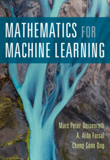
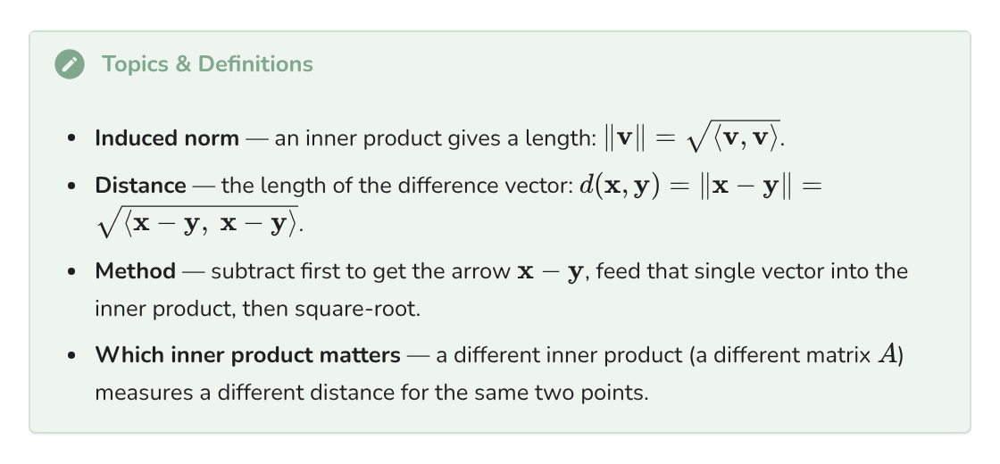
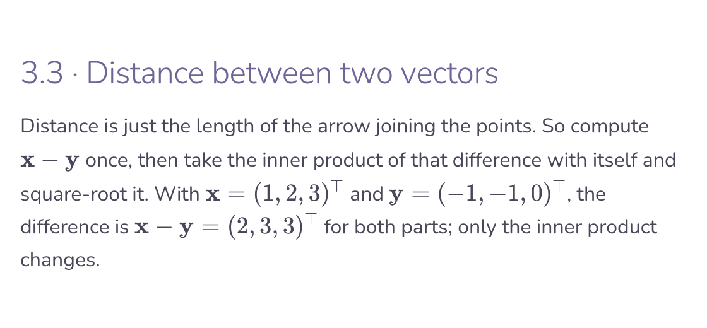
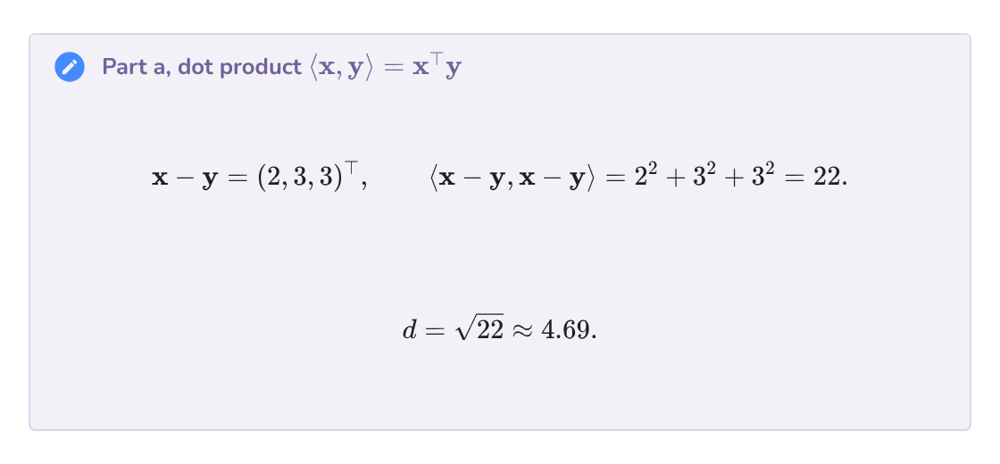
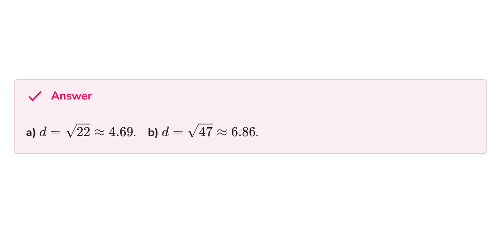

# MML Exercise Answers


Worked solutions to the end-of-chapter exercises in *Mathematics for Machine Learning* (Deisenroth, Faisal & Ong), published as a static site built with MkDocs and Material.

[](https://anp-exe.github.io/mml-exercises/)
[](https://github.com/anp-exe/mml-exercises/actions/workflows/deploy.yml)
[](https://github.com/anp-exe/mml-exercises/stargazers)
[](https://github.com/anp-exe/mml-exercises/commits/main)
[](LICENSE)

The book is great, but it doesn't come with solutions, so I made them while working through the book!

My goal is to do enough reading every day to complete one exercise, and along the way create something that is useful to other learners.

## What every solution looks like

Each exercise follows the same four part layout, so you can jump straight to the bit you're stuck on:

1. **Topics & Definitions**: the ideas the question is testing, in one place
2. **Explanation**: the approach in plain English before any maths
3. **Worked steps**: the full working with real matrices, nothing skipped
4. **Answer**: boxed, so you can check yours fast

<table>
<tr>
<td width="50%" align="center"><a href="https://anp-exe.github.io/mml-exercises/chapters/ch3/#33-distance-between-two-vectors"></a><br><sub>1. Topics &amp; Definitions</sub></td>
<td width="50%" align="center"><a href="https://anp-exe.github.io/mml-exercises/chapters/ch3/#33-distance-between-two-vectors"></a><br><sub>2. Explanation</sub></td>
</tr>
<tr>
<td width="50%" align="center"><a href="https://anp-exe.github.io/mml-exercises/chapters/ch3/#33-distance-between-two-vectors"></a><br><sub>3. Worked steps</sub></td>
<td width="50%" align="center"><a href="https://anp-exe.github.io/mml-exercises/chapters/ch3/#33-distance-between-two-vectors"></a><br><sub>4. Answer</sub></td>
</tr>
</table>

<sub>Example: exercise 3.3, distance between two vectors. Click any part to see it on the site.</sub>

Proofs live on their own [proofs page](https://anp-exe.github.io/mml-exercises/proofs/), and there's a [list of symbols](https://anp-exe.github.io/mml-exercises/#list-of-symbols) for when the notation gets dense.

## Progress

| Chapter | Exercises answered |
|:--|:--|
| [2 · Linear Algebra](https://anp-exe.github.io/mml-exercises/chapters/ch2/) | 2.1 to 2.20 complete |
| [3 · Analytic Geometry](https://anp-exe.github.io/mml-exercises/chapters/ch3/) | 3.1 to 3.10 complete |
| [4 · Matrix Decompositions](https://anp-exe.github.io/mml-exercises/chapters/ch4/) | 4.1 to 4.12 complete |
| [5 · Vector Calculus](https://anp-exe.github.io/mml-exercises/chapters/ch5/) | 5.1 to 5.9 complete, plus a bonus on multivariate Taylor series |
| [6 · Probability and Distributions](https://anp-exe.github.io/mml-exercises/chapters/ch6/) | 6.1, 6.2a (in progress) |
| 7 · Continuous Optimization | coming soon |
| 8 · When Models Meet Data | coming soon |
| 9 · Linear Regression | coming soon |
| 10 · Dimensionality Reduction (PCA) | coming soon |
| 11 · Density Estimation (GMM) | coming soon |
| 12 · Classification (SVM) | coming soon |

**Star the repo** to follow along as new exercises go up.

## Found a mistake?

I'm learning this as I go, so errors happen. If an answer looks wrong or a step doesn't make sense, please [open an issue](https://github.com/anp-exe/mml-exercises/issues/new?template=mistake.md). Every chapter page also has a link at the bottom that does this for you.

## Helpful resources

Stuck reducing a matrix to RREF? The [emathhelp RREF calculator](https://www.emathhelp.net/calculators/linear-algebra/reduced-row-echelon-form-rref-calculator/) shows every elimination step, which is handy for checking your work. For visual intuition on vectors, transformations, and matrices, 3Blue1Brown's [Essence of Linear Algebra](https://www.youtube.com/playlist?list=PLZHQObOWTQDPD3MizzM2xVFitgF8hE_ab) series is excellent. For the calculus chapters, [Paul's Online Math Notes](https://tutorial.math.lamar.edu/) are a solid reference.

## Run it yourself

The site is built with [MkDocs Material](https://squidfunk.github.io/mkdocs-material/) and the maths is rendered with KaTeX. You need Python 3.9 or newer.

```bash
pip install -r requirements.txt
mkdocs serve
```

Then open http://127.0.0.1:8000. Edits to any `.md` file reload automatically. Run `mkdocs build` to build the static site into `site/` without serving.

Every push to `main` triggers `.github/workflows/deploy.yml`, which builds the site and publishes it to the `gh-pages` branch for GitHub Pages.

<details>
<summary>Project structure</summary>

```
mml-exercises/
├── mkdocs.yml                 site config, nav, theme, extensions
├── requirements.txt           python dependencies
├── overrides/main.html        social preview tags and the footer on each page
├── .github/
│   ├── workflows/deploy.yml   auto-deploy to GitHub Pages on push
│   └── ISSUE_TEMPLATE/        "mistake in a solution" form
└── docs/
    ├── index.md               home page, progress table, resources, symbols
    ├── proofs.md              the exercises that ask for a proof
    ├── assets/                social preview image and README screenshot
    ├── figures/               diagrams used in the solutions
    ├── stylesheets/extra.css  pastel theme and admonition colours
    ├── javascripts/katex.js   KaTeX auto-render hook
    └── chapters/ch2.md … ch12.md
```

</details>

<details>
<summary>Adding answers</summary>

Open the relevant `docs/chapters/chN.md` and use the three custom boxes styled in the CSS:

```markdown
!!! theory "Topics & Definitions"
    - **Term** definition.

!!! steps "Elimination"
    $$\begin{bmatrix}1&0\\0&1\end{bmatrix}$$

!!! answer "Answer"
    $$\mathbf{x} = (\tfrac38, \tfrac38, \tfrac14)$$
```

Write maths in LaTeX between `$ … $` (inline) or `$$ … $$` (display), then update the progress tables in `docs/index.md` and this README.

</details>

## License

Solutions and site code are [MIT licensed](LICENSE). *Mathematics for Machine Learning* is © Deisenroth, Faisal & Ong, published by Cambridge University Press; the authors make it [freely available online](https://mml-book.github.io/).
